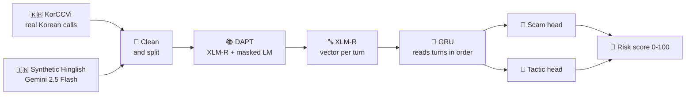

<div align="center">

# 🚨 Digital Arrest Scam Detection

### Catching scam calls in **Hinglish** with domain-adapted XLM-RoBERTa + a multi-task GRU


</div>

<p align="center">
  

</p>

---

## 📞 What is this?

Scammers pose as **CBI, police, Customs or TRAI**, claim you are "under digital arrest", and pressure you to transfer money. This project reads a call transcript and tells you:

- 🎯 **Is it a scam?** → probability for the whole call
- 🧠 **What tactics are used?** → authority · fear · urgency · threat · isolation · financial coercion, for every turn
- 🚦 **How risky is it?** → a 0–100 score: 🟢 Low · 🟡 Medium · 🔴 High

> [!WARNING]
> **Research prototype, text only, tested on synthetic data.** No real Hinglish scam-call dataset exists, so scores show the model learned *this* data, not that it works on real calls yet.

## ⚙️ How it works



| 💡 Design choice | Why |
|---|---|
| Korean + Hinglish data | Korean voice phishing uses the same fake-prosecutor script; XLM-R shares one space across languages |
| Scam / genuine-official "twin" calls (175 pairs) | Stops the shortcut *"mentions CBI → scam"* |
| Unidirectional GRU | Uses only past turns, so it can score a call in progress |
| Test set kept out of pre-training | No data leakage, checked automatically |

## 📊 Results

Tested on **340 unseen synthetic conversations**, averaged over 3 seeds.

| Task | Score |
|---|---|
| 🎯 Scam detection F1 | **0.997 ± 0.003** |
| 🧠 Tactic detection macro-F1 | **0.677 ± 0.016** |
| 🚦 Risk score: scams rated High | **166 / 168** |
| 🚦 Risk score: normal calls rated Low | **171 / 172** |

<details>
<summary><b>🧠 F1 per tactic</b></summary>

| Tactic | F1 | Share of turns |
|---|---|---|
| 💰 financial_coercion | 0.862 | 8% |
| ⏰ urgency | 0.842 | 18% |
| 👮 authority | 0.792 | 17% |
| 😨 fear | 0.642 | 6% |
| ⚠️ threat | 0.606 | 5% |
| 🤐 isolation | 0.319 | 3% |

Rarer tactic → lower score. Isolation is precise (0.82) but misses most cases (recall 0.20).
</details>

<details>
<summary><b>📚 Did domain adaptation (DAPT) help?</b></summary>

- Masked-LM loss dropped **28–42%** (mixed 2.39 → 1.55, Korean 2.45 → 1.77, Hinglish 2.26 → 1.32).
- On a simple scam / not-scam test, plain XLM-R (F1 0.971) and DAPT versions (0.970–0.978) were **not significantly different**; the test is likely too easy.
</details>

## 🗂️ Data

| Dataset | Size | Use |
|---|---|---|
| **KorCCVi** (real, Korean) | 2,924 calls · 692 scam | DAPT only |
| **Synthetic Hinglish** (Gemini) | 1,359 calls · 672 scam / 687 not · 12,822 turns | DAPT, training, testing |

> [!NOTE]
> 🔒 KorCCVi is **CC BY-NC-SA 4.0** and is **not included** here. Download it from its authors.
> All phone numbers, Aadhaar-like numbers and UPI IDs in the synthetic data are **fake**.

## 📁 Structure

```text
├── segment_pseudo_turns_manual.py    # Korean text → pseudo-turns
├── generate_synthetic_data_groq.py   # Hinglish data generator (uses Gemini)
├── synthetic_conversations.jsonl     # 1,359 synthetic calls
├── PROGRESS_REPORT.md · PROJECT_LOG.md
└── dapt_xlmr/
    ├── config.yaml                   # all settings in one file
    ├── preprocess.py · prepare_dataset.py
    ├── train_dapt.py · compare_models.py
    ├── classifier_*.py · train_classifier.py   # XLM-R + GRU detector
    └── risk_score.py                 # 0–100 risk score
```

## 🚀 Quick start

<details>
<summary><b>Click to expand</b></summary>

Tested on Linux, Python 3.12, one 8 GB GPU (RTX 5060 Laptop).

```bash
pip install -r dapt_xlmr/requirements.txt
cd dapt_xlmr

python preprocess.py --config config.yaml
python compare_models.py downstream-split
python prepare_dataset.py --config config.yaml
python train_dapt.py --experiment mixed
python train_classifier.py
python risk_score.py --test
```

Score a single call (`call.json` = `{"turns": [{"speaker": "caller", "text": "..."}]}`):

```bash
python risk_score.py --conversation call.json
```

Place the Korean data under `dapt_xlmr/data/raw/korean/{scam,normal}/` and the synthetic data under `dapt_xlmr/data/raw/hinglish/synthetic/` first. To generate more data, set `VERTEX_API_KEY` (never commit it).
</details>

## ⚠️ Limitations

- 🧪 **Synthetic data only**: train and test share one generator, so real-world scores will likely be lower
- 🏷️ Tactic labels are LLM-made, not human-checked
- 🎙️ **No audio yet**: speech-to-text, speaker separation and NER redaction are planned, not built
- 🤐 Weak on **isolation**; risk-score weights are hand-chosen, not learned

## 🛣️ Roadmap

- [ ] Test on real, consented call transcripts
- [ ] More isolation examples
- [ ] Add speech-to-text + speaker separation
- [ ] Calibrate probabilities and risk weights
- [ ] Score live calls turn by turn


</div>
